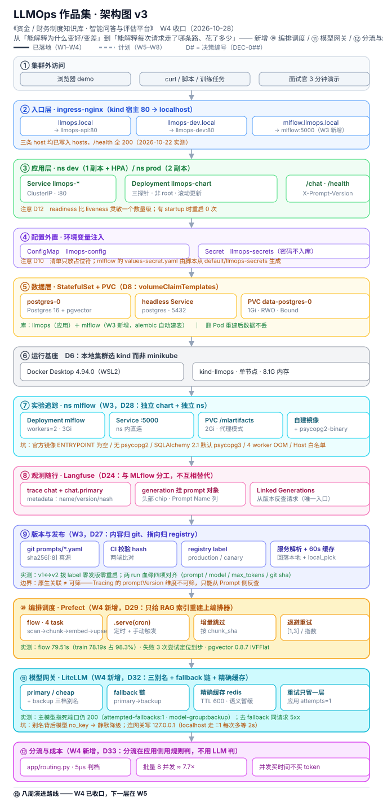

# LLMOps Engineer 作品集 · 资金/财务制度知识库智能问答与评估平台

[](https://github.com/mantou2046/LLMOps-Engineer/actions/workflows/ci.yml)

> 一个**可复现、可评估、可观测**的 LLM 应用，用来回答资金 / 财务制度类问题。
> 目标不是「能跑」，而是**能证明每次改动让系统变好还是变坏**。

- **仓库**：https://github.com/mantou2046/LLMOps-Engineer （公开）
- **学习计划与周复盘**：`E:\Projects\Obsidian\YYDS\01LLMOps-Engineer\`

---

## 问题陈述（3 句话，待细化）

1. 资金 / 财务制度分散在多个文档里，人工查找慢且容易漏，问答类工具又常常「答得像那么回事但引错条款」。
2. 本项目做一个带**引用溯源**的知识库问答服务，并且**给它的每个回答建立可量化的评估基线**。
3. 关键不是把模型接上，而是搭出一套 **检索 → 评估 → 观测 → 成本** 的工程闭环，让质量变化可测量、回归可拦截。

> ⚠️ **数据脱敏铁律**：本仓库**只放自造的、同构的样例文档**。任何来自真实单位（制度、手册、表结构、账号、内网地址）的内容一律不入库。提交前必查。

---

## 目录结构

```
LLMOps-Engineer/
├── app/            # FastAPI 服务层（LLM 调用封装、结构化输出、重试、流式）
├── infra/          # 部署与基础设施（Docker / K8s / Helm / Terraform）
├── evals/          # 评估体系（golden set、RAGAS 四指标、CI 门禁脚本）
├── data/           # 样例数据（自造脱敏文档 + 切块产物）
├── notebooks/      # 探索性实验（chunk 策略对比、检索调优）
├── observatory/    # ⭐ 本地 K8s 观测台（可视化 + 可交互，见下）
└── docs/
    ├── decisions.md   # 决策日志（每个关键选型写清「为什么」）
    └── env-setup.md   # 本机环境与已知坑
```

### K8s 观测台（`observatory/`）

一个连着你本地 kind 集群的网页控制台：**Pod 卡片墙实时刷新 +
7 个按钮直接操作真实集群**（删 Pod 看自愈、改坏探针看摘流量、
慢启动看 startupProbe、触发 OOM 看退出码 137……）。

```bash
# 双击 observatory/start.bat，或：
python observatory/server.py      # 然后打开 http://127.0.0.1:8899
```

**为什么要做它**：W1 的知识点（三种探针、自愈、就绪）如果只用
`verify_*.sh` 的「29 项全绿」来交付，你看不到任何东西，也无从判断
真假。这个工具把证据来源换成**集群自身的行为** —— 屏幕上卡片
从绿变红、RESTARTS 从 0 跳到 3，都是真实 kubectl 操作的结果，
你随时可以另开终端 `kubectl get pods -w` 交叉验证。

详见 [`observatory/README.md`](observatory/README.md)。

---

## 关键数字（README 必须写清的 5 个指标）

> 这些是面试官唯一会看的东西。每周更新一次，**必须能在本仓库里复现**。

| # | 指标 | 改动前 | 改动后 | 测量方式 |
| --- | --- | --- | --- | --- |
| 1 | faithfulness | — | — | RAGAS，`evals/` |
| 2 | context recall | — | — | RAGAS，`evals/` |
| 3 | P95 延迟 / TTFT | — | — | Grafana + 网关层埋点 |
| 4 | 每千次查询成本 | — | — | Langfuse + 云账单 |
| 5 | 语义缓存命中率 | — | — | LiteLLM 指标 |

---

## 镜像体积对比（W1 D2 产出）

> 面试常问「你怎么优化镜像」。答案不能是「用了多阶段构建」，而要有**实测数字**。
> 本节数字由 `bash scripts/verify_d2.sh` 现场测出，可复现。

**对比口径**：同一份代码，两个 Dockerfile —— `app/Dockerfile`（多阶段 + alpine + 非 root）vs `app/Dockerfile.naive`（单阶段 + 完整镜像 + root，**仅作反面教材**）。

| 镜像 | 基础镜像 | 构建方式 | 运行用户 | 体积 |
| --- | --- | --- | --- | --- |
| `llmops-api:naive` | `python:3.12`（完整版） | 单阶段，`COPY . .` | root | **1655.1 MB** |
| `llmops-api:0.1.0` | `python:3.12-alpine` | 多阶段，精确 COPY | `appuser` | **129.9 MB** |
| **减少** | | | | **92.2%（省 1525.2 MB）** |

> 基础层参考值（`docker image inspect` 实测）：`python:3.12-alpine` 79.1 MB / `python:3.12.7-slim-bookworm` 176.5 MB / `python:3.12` 完整版 ~900 MB。
> 最终镜像相对 alpine 基础层只净增 **50.7 MB**，即「venv 66.9 MB 去掉 pip/setuptools/wheel 之后」+ 应用代码。

**为什么最终选了 alpine 而不是 slim**（这是本轮优化里最有价值的一段）

一开始用 `python:3.12.7-slim-bookworm` 做基础层，优化到 **247 MB** 就压不动了 ——
因为 **slim 基础层本身就占 176.5 MB，物理上不可能满足「< 200MB」**。于是换 `python:3.12-alpine`：

| | slim-bookworm | alpine |
| --- | --- | --- |
| 基础层 | 176.5 MB | **79.1 MB** |
| 最终镜像 | 247 MB | **129.9 MB** |
| 是否达标 < 200MB | ❌ | ✅（余量 70 MB） |

换 alpine 的唯一风险是 **musl libc 而非 glibc** —— 带 C 扩展的包如果没有 musllinux wheel，
就得在镜像里装 `gcc` + `musl-dev` 现场编译，把省下的体积全吃回去。
**所以动手前先验证，而不是构建失败了再发现**：

```bash
# 在 alpine 里跑一次真实安装，不装任何编译器
docker run --rm python:3.12-alpine sh -c '
  pip install --no-cache-dir -r requirements.txt && echo WHEELS_OK'
```

结果全部命中预编译 wheel，构建日志可直接佐证：

```
uvloop-0.23.0-cp312-cp312-musllinux_1_2_x86_64.whl
watchfiles-1.3.0-cp310-abi3-musllinux_1_1_x86_64.whl
websockets-17.2-cp312-cp312-musllinux_1_2_x86_64.whl
```

⚠️ 因此 `app/Dockerfile` 的 builder 段**故意不装 gcc**。哪天某个依赖开始只发 sdist，
构建会立刻**报错**而不是悄悄变慢 —— 这是理想的失败方式。
⚠️ 同理 runtime 段**不装 curl**：alpine 自带 busybox 的 `wget`，HEALTHCHECK 用
`wget -q -T 3 --spider` 即可；为「让 curl 可用」去 `apk add curl` 会带回
`ca-certificates` 等约 4~8 MB，与体积目标背道而驰。

**跑法**

```bash
cp .env.example .env      # 填 POSTGRES_PASSWORD
bash scripts/verify_d2.sh # 一条命令：建两个镜像 + 比体积 + 验非 root + 验 pgvector
```

结束后善后（**保留数据卷**）：

```bash
docker compose --env-file .env -f infra/compose.yml down
```

> ⚠️ **手动敲 compose 命令时务必带 `--env-file .env`**（脚本内部已封装）。
> 否则 compose 找不到 `.env`，会报一长串
> `required variable POSTGRES_PASSWORD is missing a value` —— 看起来像配置坏了，
> 其实只是**环境文件没被加载**。`docker compose` 默认只从当前工作目录找 `.env`，
> 换个目录执行就失效。

### 多阶段省在哪（原理）

镜像体积来自**层**。单阶段把所有东西都堆在最终镜像里：

| 内容 | 单阶段 | 多阶段 |
| --- | --- | --- |
| 基础镜像 | `python:3.12` 完整版（含编译器、文档、apt 缓存） | `python:3.12-alpine`（79.1 MB） |
| 构建工具链 | `gcc` / `build-essential` 留在镜像里 | builder 段**根本不装**（依赖全是预编译 wheel） |
| pip 缓存 | 常在镜像里 | `--no-cache-dir` 不留 |
| pip / setuptools / wheel | 留在镜像里（约 15 MB） | 在 **builder 段**装完即删 |
| apk/apt 列表 | 常在镜像里 | 与安装同层 `rm -rf` |
| 源代码 | `COPY . .` 可能带 `.git` / `data/` | 精确 COPY + `.dockerignore` |

> ⚠️ **一个反直觉点**：清理动作（`rm -rf /var/lib/apt/lists/*`、删 pip）必须和「产生它的那条命令」写在**同一条 RUN** 里。
> 拆成两条 RUN 的话，删除只是在上一层之上盖一个**删除标记（whiteout）**，底下那层的数据**仍然在镜像里** —— overlayfs 是叠加的，不是覆盖。
> 这就是「层」这个概念的实际影响。

> 📌 **本项目真实踩坑（比上面的通用提醒更值得记）**：
> 优化到 270 MB 时，我把「删 pip / setuptools」写进了 **runtime 段**，心想「反正最后删掉就小了」。
> 结果镜像**涨到 284 MB** —— 因为 `COPY --from=builder /opt/venv` 那一层已经把 pip 拷进来了，
> 后面的 `RUN rm` 只加了一个删除标记，底层那 ~15 MB 依然在。
> 把它挪回 **builder 段**（装完就删，这样 COPY 过去的 venv 天生就是精简的）之后降到 247 MB。
> **「把删除放到后面」是错的直觉 —— 删除要放到「数据进入镜像之前」。**

### 层缓存顺序（BP4）

```dockerfile
COPY requirements.txt ./          # ① 依赖声明：低频变动
RUN pip install -r requirements.txt  # ② 装依赖：只有 ① 变了才重跑
COPY app/main.py ./               # ③ 源码：高频变动
```

反过来写（先 `COPY . .` 再装依赖）的话，**改一行代码就会让依赖层缓存全部失效**，每次构建都要重装几十个包。

---

## 快速开始

> 依赖与网络配置见 [`docs/env-setup.md`](docs/env-setup.md)（含代理端口、pip 源、HF 镜像的**实测结论**）。

```bash
cp .env.example .env          # 填入自己的密钥
python -m venv .venv && source .venv/Scripts/activate
pip install -r requirements.txt
```

### 容器化跑法（推荐把依赖关进容器）

> ⚠️ 本机原来没装 Docker，安装见 [`infra/DOCKER-SETUP-Win11.md`](infra/DOCKER-SETUP-Win11.md)（含实测下载地址与代理配置）。

```bash
cp .env.example .env                          # 至少填 POSTGRES_PASSWORD

# 构建多阶段镜像
docker build -f app/Dockerfile -t llmops-api:0.1.0 .

# 起 Postgres + pgvector
docker compose -f infra/compose.yml up -d
docker compose -f infra/compose.yml ps        # 等 postgres (healthy)

# 一条命令跑完 W1 D2 的三条验收
bash scripts/verify_d2.sh
```

| 验收项 | 标准 |
| --- | --- |
| 镜像体积 | 多阶段 < 200MB，且显著小于朴素单阶段 |
| 非 root | 容器内 `whoami` ≠ `root` |
| pgvector | 能写入向量并完成最近邻检索 |

---

## 本地 K8s 跑法（W1 D3 / D4 / D5 产出）

> 用 [kind](https://kind.sigs.k8s.io/) 在 Docker 里起一个单节点集群。
> **为什么选 kind 而不是 minikube**：见 [`docs/decisions.md`](docs/decisions.md) D6。

```bash
# 一条命令跑完 D3 的三条验收（建集群 → load 镜像 → apply → 校验 → 自愈演示）
bash scripts/verify_d3.sh

# 一条命令跑完 D4 的三条验收（配置外置 → 持久化 → Ingress）
bash scripts/verify_d4.sh

# 一条命令跑完 D5 的验收（三种探针 + 三种排错演练）
bash scripts/verify_d5.sh
```

| 验收项（D3） | 标准 | 实测 |
| --- | --- | --- |
| Pod 全部 Running | `kubectl get pods` | ✅ 2/2，**13 项全绿** |
| 服务能访问 | `port-forward` + `/health` 返回 `status:ok` | ✅ |
| Service Endpoints | 非空（证明 selector 与 labels 匹配上） | ✅ 2 个 endpoint |

| 验收项（D4） | 标准 | 实测 |
| --- | --- | --- |
| 配置外置 | ConfigMap + Secret 容器内可读 | ✅ **19 项全绿** |
| ⭐ **数据持久化** | 删 Pod 重建后数据还在 | ✅ `INSERT` → `delete pod` → 重建 → `SELECT` count=1 |
| **Ingress** | 宿主 80 端口能按 Host 路由到服务 | ✅ `Host: llmops.local` → **200**；错误 Host → **404**（负向验证） |

| 验收项（D5） | 标准 | 实测 |
| --- | --- | --- |
| 三种探针配置 | startup / liveness / readiness 路径与参数正确 | ✅ **29 项全绿** |
| ⭐ **startupProbe 有效性** | 同样 45s 慢启动，有 startup 应零重启 | ✅ 反面（无 startup）**重启 4~5 次起不来** vs 正面 **0 次 `1/1 Running`** |
| ⭐ **readiness 摘流量** | 失败 → 摘出 EndpointSlice 但**不重启** | ✅ `0/1 Running` + 端点数 **2→1→2** + **RESTARTS=0** |
| 排错判据 | 三种故障各有可断言的特征 | ✅ `ErrImagePull` / `OOMKilled`+**137** / `Running` 但 `READY=0/1` |

### 三种探针怎么配的（D5）

**参数按「失败代价」推算，不是照抄**：

| 探针 | 路径 | period × threshold | 容忍窗口 | 失败后果 |
| --- | --- | --- | --- | --- |
| `startupProbe` | `/health` | 2s × 30 | **60s** | 杀容器（仅启动期） |
| `livenessProbe` | `/health` | 10s × 3 | **30s** | **重启容器** |
| `readinessProbe` | `/ready` | 3s × 2 | **6s** | **摘出 EndpointSlice**（不重启） |

**核心权衡**：readiness 的误判代价只是「短暂少一个副本接流量」→ 可以激进（6s）；
liveness 的误判代价是「重启容器 + 可能进 CrashLoop 恶性循环」→ 必须保守（30s）。
⚠️ **若 startup 的窗口 ≤ liveness 的窗口，startup 形同虚设** —— `verify_d5.sh` 里有断言检查这个不等式。

**为什么 liveness 打 `/health` 而 readiness 打 `/ready`**：liveness 若查数据库，
数据库抖动会导致容器被反复重启，而**重启解决不了数据库问题** —— 把「外部依赖故障」
放大成「服务全面不可用」。外部依赖的检查属于 readiness（此时摘流量是正确的）。

**两个「默认关闭」的演示旋钮**（`app/main.py`，D13）：

```bash
# ① 模拟慢启动（默认 0 = 行为不变），用于演示 startupProbe
kubectl set env deployment/llmops-api STARTUP_DELAY_SECONDS=45

# ② 注入「就绪失败」（默认不激活），演示摘流量但不重启
kubectl exec deploy/llmops-api -- touch /tmp/not-ready
kubectl get pods                      # → READY 0/1，STATUS 仍是 Running
kubectl exec deploy/llmops-api -- rm -f /tmp/not-ready
```

⚠️ **`READY 0/1` + `STATUS Running` 是最易误判的一种故障**：容器没崩、`RESTARTS=0`、
`logs` 也正常，但服务就是不接流量。定位靠 `kubectl get endpoints`（端点变少/为空）
或 `describe pod` 里的 `Readiness probe failed`。

**不想敲命令看这些现象？用观测台（`observatory/`）：**

```bash
python observatory/server.py     # 打开 http://127.0.0.1:8899
```

上面那两个旋钮、以及「删 Pod 看自愈」「改坏探针对照 readness vs liveness」
「触发 OOM 看 137」都做成了按钮。点一下，**卡片当场变红/变绿**，
右侧同时显示执行了哪条 kubectl —— 想核实就照着敲一遍。
详见 [`observatory/README.md`](observatory/README.md)。

📖 探针原理与参数推算详见 [`docs/decisions.md`](docs/decisions.md) D12–D14。

### 清单文件

```
infra/k8s/
├── app.yaml                 # Deployment(2 副本，三探针) + Service(ClusterIP)  [D3/D5]
├── config.yaml              # ConfigMap llmops-config + Secret llmops-secrets  [D4]
├── postgres.yaml            # headless Service + StatefulSet + initdb ConfigMap [D4]
├── ingress.yaml             # Ingress 规则（host: llmops.local）              [D4]
├── kind-ingress-config.yaml # 带 extraPortMappings 的集群配置                 [D4]
└── ingress-nginx/
    └── deploy-upstream.yaml # ingress-nginx 控制器清单（已打 2 处补丁，见下）   [D4]
```

### Ingress 一键安装（⚠️ 会删库重建集群）

```bash
bash scripts/setup_ingress_kind.sh            # 有二次确认
bash scripts/setup_ingress_kind.sh --yes      # 跳过确认
```

`extraPortMappings` 只在**建集群时**生效，所以装 Ingress 必须 `kind delete cluster` + 重建。
脚本会先让你确认，并处理下面三个坑（全部实测踩过）：

1. **清单下载** —— 沙箱 env 代理拦 `raw.githubusercontent.com` → 走注册表代理 `127.0.0.1:9527`，
   清单**落盘进仓库**（`infra/k8s/ingress-nginx/deploy-upstream.yaml`）。
2. **清单两处补丁** —— Service `LoadBalancer`→`NodePort`(30080/30443)；**去掉 `@sha256:` digest 钉死**。
3. **节点 containerd 代理** —— kind 把宿主 `HTTP(S)_PROXY` 注入节点，而节点内部的
   `127.0.0.1` 指向节点自己 → 任何回源都 `connection refused`。脚本会加 systemd drop-in
   清掉它（`Environment=` 清空 + `NO_PROXY=*` 兜底）。

### ⚠️ kind 的三个经典坑（都实测踩过）

1. **镜像必须显式 load**。kind 的「节点」是**独立容器**，看不到宿主机的 `docker images`。
   不 load 就一定拉不到 —— 而且如果镜像用 `latest` + `imagePullPolicy: Always`，
   kubelet 还会**绕过本地镜像**去 Docker Hub 拉一个不存在的 tag → 直接 `ImagePullBackOff`，
   而镜像明明就在节点里。**所以用具体 tag + `IfNotPresent`**（见 `docs/decisions.md` D7）。

2. **multi-arch 镜像载入失败**。`kind load docker-image pgvector/pgvector:pg16` 会报
   `ctr: content digest ...: not found`。绕法：
   ```bash
   docker save pgvector/pgvector:pg16 -o pgv.tar
   docker cp "E:\Projects\LLMOps-Engineer\pgv.tar" llmops-control-plane:/pgv.tar
   docker exec llmops-control-plane ctr -n k8s.io images import \
       --platform linux/amd64 /pgv.tar
   ```
   完整归因（代理泄漏 + 外平台层）见 `docs/decisions.md` D9。

3. **digest 引用 + 节点代理 = 永远拉不到**。清单里写 `image: xxx@sha256:...` 时，
   kubelet 会拿 **digest 去远端校验 manifest**（不查本地），而节点代理指向 `127.0.0.1`
   → `ErrImagePull`，**且 `imagePullPolicy` 设什么都没用**。修法见 D11
   （去 digest + 清节点 containerd 代理）。

### 清理

```bash
kind delete cluster --name llmops
```

---

## ⚠️ Docker 数据盘已迁到 E 盘（2026-10-09 完成）

**关键认知：项目源码在 E 盘 ≠ 数据在 E 盘。**

`E:\Projects\LLMOps-Engineer` 本身只占 **618 KB**（纯源码）。但 kind 的「节点」
本质是 **Docker 容器** —— 它的文件系统、每个镜像层、postgres 的 PVC 数据卷，
**全部写在 Docker 的数据盘里**。

| | 位置 | 状态 |
| --- | --- | --- |
| 迁移前 | `C:\Users\lile2\AppData\Local\Docker\wsl\disk\docker_data.vhdx` | 11.5 GB，C 盘只剩 37G |
| **迁移后** | **`E:\Projects\DockerData\DockerDesktopWSL\`** | **11.55 GB，C 盘回到 48G** |

📄 **迁移步骤见 [`docs/docker-data-move-to-E.md`](docs/docker-data-move-to-E.md)**
（目标位置 **`E:\Projects\DockerData`** —— 与代码仓库平级，见下方「为什么」）。

⚠️ `docker rmi` **不会让 vhdx 变小** —— 必须迁移或压缩才能真回收。
💡 **迁移后 kind 集群原样恢复，无需重建**（实测）；`verify_d4.sh` 19 项全绿，postgres 数据完好。
✅ C 盘旧 vhdx 由 Docker Desktop **自动清理**（`AppData\Local\Docker` 12 GB → 9.1 MB）。

**为什么数据盘不放在本项目目录里**：Docker 数据盘是**全局的**，装着所有项目共用的
镜像 / 容器 / 卷，不属于任何单个仓库。放进去会让一个 618 KB 的代码仓库看起来有 12 GB，
备份和同步时也会连带搬运。所以 `E:\Projects\` 下区分两类目录 ——
代码仓库（进 Git、常备份）与大数据目录（`DockerData` / `AIModel` / `FileStorages`，平级而非嵌套）。

---

## 启用提交前脱敏检查（克隆后必做一次）

本仓库是**公开**的，所以有一道提交前门禁，防止手滑把凭据或内部信息推上去。

```bash
git config core.hooksPath .githooks
cp scripts/sensitive_terms.example.txt scripts/sensitive_terms.txt   # 填自己的敏感词
python scripts/check_sensitive.py --all                              # 手动全树扫一遍
```

检查内容分三层：

| 层 | 内容 | 触发时机 |
| --- | --- | --- |
| 内置规则 | 私钥、各类 API Key / Token、JWT、**内网 IP 段**、带口令的连接串、疑似凭据键值 | — |
| 自定义词表 | `scripts/sensitive_terms.txt` 里的单位名 / 内网域名 / 真实表名字段名 | — |
| 本地钩子 | `.githooks/pre-commit` 扫**暂存区**，命中即阻止提交 | `git commit` |
| CI 兜底 | `.github/workflows/ci.yml` 扫**全树**，防止本地没装钩子的人绕过 | push 到 main / PR |

> ⚠️ 脚本**只报「文件:行号 + 命中类型」，绝不回显命中的原文** —— 否则检查工具本身就成了泄露渠道。
> ⚠️ `scripts/sensitive_terms.txt` 被 gitignore，**真实词表只留本地**。
> ✅ 两道门禁均已实测生效（2026-10-07）：本地钩子在提交时扫描 7 个暂存文件；CI 在首次 push 时扫描全树 14 个文件并通过。

---

## 架构图（v3 · W4 收口）



> 十二层，分三段：**①–⑥ 运行基座**（入口 / 应用 / 配置 / 数据 / kind）· **⑦–⑨ 版本与可解释**（MLflow 实验追踪 / Langfuse 观测随行 / git→registry 发布指针）· **⑩–⑫ 编排与流量**（Prefect 调度 / LiteLLM 网关 / 应用侧规则分流与批量并发）。
>
> W4 的核心设计是**每层只管一件事**：编排器管调度、应用管分档、网关管模型与缓存——配置跟着层走，不跟着人走。所以网关别名背后的模型当天换了三次，**应用代码零改动**。
>
> 关键证据（可在本仓库复现）：flow 79.51 s（`train_model` 占 98.3%）· 判档 4.8–6.0 µs/次 · 故障转移 200 vs 去 fallback 的 5xx · 缓存 1161.6 → 10.3 → 8.9 ms · 并发 8× vs 串行 7.7×（token 一位不变）。

---

## 进度

> **最后更新：2026-11-09**（每次推进后同步本表，别让它变成装饰品）

对照学习计划：`E:\Projects\Obsidian\YYDS\01LLMOps-Engineer\`（八周 10/7 → 11/30）

| 周 | 日期 | 主题 | 状态 | 关键产出 |
| --- | --- | --- | --- | --- |
| W1 | 10/7 – 10/11 | 起手与环境、Docker、K8s 起手 | ✅ **完成**（D1–D5） | 镜像 1655→129.9 MB（−92.2%）；kind 集群 + 三探针 29 项验收全绿；`observatory/` 观测台 |
| W2 | 10/12 – 10/18 | K8s 生产化、上云、服务化 + 观测 | ✅ **完成**（D6–D12） | Helm 发布、RBAC 最小权限、PDB + 反亲和、dev/prod 隔离、指数退避重试、Langfuse trace；**阶段一验收 10/18 达成** |
| W3 | 10/19 – 10/25 | 实验追踪与模型管理 | ✅ **完成**（D13–D19） | MLflow 四条 run（prompt v0/v1 对比，`refusal_rate` 0.0→0.2 两组复现、`format_ok` 恒 1.0）；模型按 alias 注册；prompt 版本化（git 真源）；MLflow 独立 chart 上 K8s；DEC-022~028 |
| W4 | 10/26 – 11/1 | 编排、部署与网关 | ✅ **完成**（D1–D7，**领先约 3 天**） | Prefect 第一个 flow + RAG 索引重建流水线（增量 + task 级重试，flow 79.51 s / train 占 98.3%）；部署三形态实测（在线 p50 15 ms / 离线 7.4 万行 0.64 s / 不做流式）；离线批量打分 `evals/batch_score.py`（8 并发 1.05 s vs 串行 8.08 s ≈ 7.7×，token 成本四组一位不变）；LiteLLM 网关三别名 + 故障转移（200 vs 去掉 fallbacks 的 5xx，缓存 1161.6→10.3→8.9 ms）；**应用侧规则分流器 `app/routing.py`**（判档 4.8–6.0 µs/次、离线 24 条 12/12 与标注 0 条不符、在线 18 条分流全对且缓存 6/6 命中）；**M3/M4 作业 12 题全答**；DEC-029~033 |
| W5 | 11/2 – 11/8 | 监控、工程规范与 IaC | ✅ **完成**（11/4 收口，提前 4 天；D1–D6 全绿） | **D1** Prometheus 指标采集打通：`app/metrics.py` 一条中间件装出「请求数 / 耗时 / 在飞数」（**错误数不单独做 counter**）+ `/metrics` 端点；Prometheus v3.15.1 容器抓取（5 s 间隔，单次 8.5 ms / 106 样本 / 10 KB）；五条 PromQL 验通（错误率 **0.2308 = 6/26**）；基数实验 30 个不同 404 路径仍只 **1 条**时序、1000 个 label 值 → **116 KB / 14 ms**；**两个失真实测**：流式请求客户端 1.641 s 而指标只记 0.424 s（只到 TTFB）、双 worker 连抓 6 次读到 5/5/5/7/7/5。**D2** Grafana 13.2.5 看板 + Evidently 0.7.23 漂移报告：`infra/grafana/` 三件套 provisioning 入版本库（datasource uid 写死 + 看板 JSON + `allowUiUpdates: false`），8 块面板（4 数字 + 4 曲线）；QPS 0.212→0.929（**4.4×**）、峰值 2.182、P95 `/chat` **4.75 ms**、抓取 6.05 ms；漂移三场景实测（control 2/6 列漂移 p=7.78e-04、coldstart p=2.81e-15、injected 3/6 = **50.0%**）；DEC-034 定「**看板只画能回答问题的图**」。**D3** LLM 专属指标：网关开 `callbacks: ["prometheus"]`（不开 `/metrics` 404）+ 关指标鉴权（默认 401，鉴权路径要 prisma/DB）+ 三个 `local-*` 档位与 `model_info` 显式定价；Prometheus 加 `litellm-gateway` job（`metrics_path` 须带斜杠）；可控假上游 `scripts/fake_upstream.py`（首包 300ms / usage 写死 100/50）+ `scripts/gateway_load.py` 五组流量 → **17 请求 = 12 次真实上游调用 + 2 次缓存命中 + 3 次打不通**（与上游 `/stats` 独立对账）；单次成本 cheap **2e-5** vs primary **2e-4**（正好 10 倍）、P95 TTFT **0.4875 s**（真实约 0.33 s，桶宽插值）、命中率 **11.6%**；**三个「数字会骗人」**：`cache_misses` 只对流式记（教科书公式算成 50%）、P95 被桶宽放大 84%、上游失败 20% 而错误率面板 **0%**（被重试吃掉）；看板 `llmops-llm.json` **10 块** |
| W6 | 11/9 – 11/15 | RAG 与评估（进度落后时优先保） | ✅ **完成**（11/5 开工、11/8 收口；周验收四条落地，D3 按双指标口径验收通过，DEC-047） | **D1** 三种切法 5 配置实跑选递归 B（400/50）：512 硬切块尾完整率仅 **7.2%**、按标点切到 **42.8%**；语料冻结到 `evals/corpus/`（commit `6ba1baf`，104,798 字符）；`rag_chunks` 从 29 行 `vector(384)` fake 迁成 **330 行 `vector(512)` 真向量**，六条灌库复验清单全勾——精确检索 hit@5 **10/10**、hit@1 7/10、MRR 0.825 与离线基线逐项对上；**ANN 坑实测**：IVFFlat 默认 `probes=1` 三次掉成 9/10、9/10、7/10（漏题随索引重建漂移），`probes=3` 三次稳定 10/10。**D2** BM25 + RRF 融合：hit@1 向量 7/10 → **RRF 10/10**、MRR 0.825 → **1.0**，生产库三路复验逐项对上；接 `bge-reranker-base` 量延迟，向量查询约 4ms、精排 top-5 净增 **2.2–2.4s**（约 530–620 倍）→ 默认不开，关键词判据下掉分属尺子错配，等 golden set 重评。**D3** 50 题 golden set 标完（`--strict` 0，答案逐字可核 23 / atoms 兜底 15），网页版点选答题的候选句全部来自冻结语料原文、人选的句子才成为标准答案；三个 AI 代理三轮独立复标未达旧线 0.8，**2026-11-09 用户拍板改判定口径，按预留双指标（平均 Jaccard 0.816 / 严格一致 70.2%）验收通过**（`evals/ACCEPTANCE.md` §口径变更与验收结论、DEC-047），⚠️ 不是原线达标、也不是真人双标。**D4** 接最小 RAG 链路（递归 B + RRF top-5 → 网关生成），用带 `reference` 的正式口径跑 RAGAS 四项，首份基线报告 `evals/RAGAS_BASELINE.md`；10 题小样四项基线 **0.9714 / 0.5817 / 0.9200 / 0.8988**（末项 9/10，`g006` 内部超时）；裁判从 AMD 那条 `deepseek-v4-flash`（429 冷却 65–86 秒 + 一次 504）换成网关 `auto` 路由（压测 15/15、平均 1.58 秒、不走 AMD）。`deepseek-v4.1-flash` 在 catalog 里 `no_key` 用不了。**D5** 单变量 A/B 归因（只改生成 prompt 第 3 条输出格式）：answer relevancy 配对 Δ **+0.0046**，小于理论不该变的 context recall 噪声标尺 **+0.0074**，逐题 5 涨 5 跌、σ 0.3718；faithfulness 反从 0.9214 掉到 **0.8000**（−0.1214，`g002` 被误判成拒答）→ 判定改动无效，不并入生产链路；报告 `evals/ATTRIBUTION.md`、脚本 `scripts/w6d5_attribution.py`。**D6** 先补 `source_chunk` 回填：按递归 B 切法把 38 道可答题的标准答案逐字核进 330 块（与 D1 逐字对账），12 道拒答题保持 `null`，`--strict` 退出 0、diff 只有一列；再上**零依赖非 LLM 门禁** `eval-gate` job：20 题确定性分层抽样子集、字符 bigram BM25、`IDBasedContextRecall@5` **0.75**（全量 38 题 **0.8421**）、阈值 **0.65**，改坏 query 模板塌到 **0.0** 且退出 1，`--self-test` + 3 条单测把「改坏 prompt 被 CI 拦下」自动化；`ruff` 全绿、`pytest` 29 passed。报告 `evals/SOURCE_CHUNK_BACKFILL.md` / `evals/CI_EVAL_GATE.md`。**D4 全量补跑（11-08，固定裁判 `glm-5.3-flash` 直连官方 `/v1`）**：50 题四项 50/50 全齐、NaN 0，均值 **0.9434 / 0.4768 / 0.8113 / 0.8591**；分组报分补齐，12 道拒答题 AR 仅 **0.0524**、CP **1.0000**，可答题 AR 0.6108，混进全量均值会掩盖差异；`g006` 与 `g042` 的缺分都补回。见 `evals/RAGAS_BASELINE.md` §全量复跑。**周复盘（11-08 提前写完）**：对比数字与三问成稿 [`docs/W6_WEEKLY_REVIEW.md`](docs/W6_WEEKLY_REVIEW.md)，结论证伪、无提升数字；D5 独立裁判交叉验证、拒答/boundary 配对扩展、rerank 复核与 probes 接线见各 `evals/` 报告。DEC-039~046 |
| W7 | 11/16 – 11/22 | 护栏、成本、微调与 Agent | 🟡 **提前开工**（11/09 开做 D1–D5；D1 / D2 / D3 / D5 按日验收线判完成，D4 部分完成待云端补跑，周里程碑未验收） | **D1** 输入护栏：`app/input_guard.py` 规则基线 10 条攻击拦 9/10、正常请求误拦 0/5，另接 `prompts/input_guard/v1.yaml` 模型判定补住 A10（判 block / secret_extraction，`/chat` 400）；Docker mock 注入 400 / 正常 200。**D2** 输出护栏：`app/output_guard.py` 的 `answer` / `citations` 白名单 + 格式错最多修一次 + 固定兜底 + 个人信息遮盖；10 条样例 10/10、全量 73 项 pytest 通过，`llmops-api:w7d2` 容器结构化请求 HTTP 200 且 `degraded=true` / `format_repair_failed`、流式 HTTP 422；**真实检查器已接**：`prompts/output_toxicity/v1.yaml` + `prompts/output_grounding/v1.yaml` 与 `judge_toxicity` / `judge_grounding` 复用 D1 的 `llm.chat` 范式，由默认关闭的 `OUTPUT_GUARD_MODEL_JUDGE_ENABLED` 注入 `/chat`（结构化分支两个判定器 + 可选 `context`，非结构化分支只跑毒性），真实模型四条判定 4/4、三条组合 3/3，mock 下拒绝冒充并安全兜底。**量化评估**（[`evals/OUTPUT_GUARD_BENCH.md`](evals/OUTPUT_GUARD_BENCH.md)）：30 条标注样本，修掉模型重复输出 JSON 后解析失败 16/30 → 0，有效 28/30 里误拦 0 / 漏拦 0 / 依据判错 0；单次判定 P50 1.849s / P95 10.004s，一次结构化回答额外约 513 tokens；容器连真实上游完整链路已跑通（`upstream_mode=openai`，判定状态不再是 `not_checked`），全量 pytest 78 项。⚠️ 判定开关仍默认关闭：20s 超时下 2/30 会 fail-closed，串行两次判定明显拉长 `/chat`；真实流量分布下的误拦率未量。**D3** 成本控制：`app/cost.py` 精确缓存 + 规则分流 + Token 审计，`/chat` 两个默认关闭开关；20 条题集四组同条件压测每千次成本点数 **1754.6 → 626.5（−64.3%）**，只开分流 −61.5% / 只开缓存 −27.8%，命中率 28.4%、便宜档 69.7%，分流一致率 20/20；容器 `MISS → HIT` 且命中用量归零；18 项单测、[`evals/COST_BENCH.md`](evals/COST_BENCH.md)。⚠️ 语义缓存本机跑不起来（W4 D5 实测三缺），成本点数是演示单位、非模型成本单列未计入。**D4** 微调：本机无 GPU 且缺 torch/peft，**真 LoRA 未跑**；交付纯 numpy 低秩适配实跑（参数 4096 → 512 = 12.5%、产物 12.8%，留出 MSE 0.000146 vs 0.000106，r=1 学不全停 190.111）、8 项单测与云端 `notebooks/w7d4_lora_colab.py` 骨架（未执行、preflight 退出码 2），按日验收线**部分完成**，见 [`evals/LORA_DEMO.md`](evals/LORA_DEMO.md)。**D5** 决策对照表：[`docs/W7_D5_DECISION.md`](docs/W7_D5_DECISION.md) 按「给决策层讲」成稿，每条结论挂 10 条证据编号；`app/decision.py` 规则选择器 + 12 条人工标注场景 **12/12 一致、证据覆盖 100%、微调仅 1/12 且带「效果未量」声明**，22 项单测；全量 pytest **126 项**。五篇实践笔记与复现命令在知识库 |
| W8 | 11/23 – 11/30 | 作品集打包与求职启动 | ⬜ 未开始 | — |

**当前在做**：W7（11/16–11/22）护栏、成本、微调与 Agent，11/09 提前开做。**D1 输入护栏已跑完**：规则 9/10 + 模型判定补住 A10，Docker mock 注入 400 / 正常 200；**D2 输出护栏已完成日验收**：规则基线 10/10、全量 pytest 78 项、容器结构化 200 且安全兜底、流式 422，毒性 / 资料依据接了真实模型判定（4/4 + 3/3），30 条量化评估与容器连真实上游链路见 [`evals/OUTPUT_GUARD_BENCH.md`](evals/OUTPUT_GUARD_BENCH.md)（误拦 0/10、漏拦 0/8、单次判定 P50 1.849s、一次结构化回答 +513 tokens）。两天的实践笔记都在知识库，含 PowerShell 与 Git Bash 复现命令。⚠️ 判定开关仍默认关闭：20s 超时下 2/30 会 fail-closed，串行两次判定拉长 `/chat`；真实流量分布的误拦率未量。**11/09 晚间续做 D3–D5**：D3 成本控制、D5 决策对照表均按日验收线判完成；**D4 微调只到部分完成** —— 本机 CPU-only 且缺 torch/peft，真 LoRA 训练未跑，只有 CPU 数学实跑与云端脚本骨架，不编训练结果。全量 pytest 126 项、新增文件 ruff 全过（`app/main.py` 3 条存量 E501 非本次引入）。两条待办：① 云端补跑真微调并回填训练前后格式符合率；② D1 临时开的 FreeLLMAPI「Allow LAN access」待关。11/21 起按原计划推进 Agent 与周复盘。

**W6 已收口**（11/8 完成，11/9 D3 口径变更收口）：**11/9、11/10 两天全天完结**：递归 B（400/50）写成正式基线；混合检索生产复验 + rerank 延迟测量，结论默认不开。**11/11 / 11/12 提前跑过**：50 题 golden set 标完但复标验收未过（`evals/ACCEPTANCE.md`）；RAGAS 已于 11-08 用固定裁判 `glm-5.3-flash` 跑完 50 题全量 + 分组报分（四项 50/50 全齐、NaN 0，见 `evals/RAGAS_BASELINE.md` §全量复跑）。**11/13 已实跑**：单变量 A/B 归因证伪了「改 prompt 能提 relevancy」；11-08 晚间再用独立裁判 `glm-5.3-flash` 重评同一批 A/B 配对做交叉验证，四项 10/10 全齐（含此前全缺的 context precision），**「改动不采纳」维持原判**，详见 `evals/ATTRIBUTION.md` §独立裁判交叉验证。**11/14 已实跑**：`source_chunk` 回填 + 非 LLM eval 门禁进 CI，详见 `evals/CI_EVAL_GATE.md`。**11/10 复核补做**：按 DEC-042 用带 reference 的 context precision 重评 rerank（20 题分层抽样，基线 top-5 与 D4 逐字一致 20/20），CP 0.7843 → 0.8451 但配对 Δ +0.0608 落在 σ 0.2399 里、精排 P50 4545 ms，**默认不开维持**，详见 `evals/RERANK_RECHECK.md`；`app/retrieval.py` 把 `ivfflat.probes = 3` 收敛成应用侧统一连接入口 + 6 条集成测（DEC-041 补记）。**11/15 提前收口（11-08 晚间）**：周复盘与「改动前 / 后」对比数字成稿在 [`docs/W6_WEEKLY_REVIEW.md`](docs/W6_WEEKLY_REVIEW.md)（简历素材正本；两轮单变量 A/B 都判定不采纳，结论**证伪、无提升数字**）；周验收四条全部落地，D3 已于 2026-11-09 按预留双指标口径验收通过（Jaccard 0.816 / 严格一致 70.2%，DEC-047；⚠️ 旧线 0.8 未达、标注员为 AI 代理） → 按现行口径评估体系闭环；D5 的 A/B 10 题全是可答题（`single_hop` 8 / `multi_hop` 2），按现有题型切片已于 11-08 离线补算在 `evals/ATTRIBUTION.md` §按题型切片（零 LLM 调用，判定对题型不敏感）；12 道应拒答与 3 道 `boundary` 的**配对样本**已于 11-08 晚间补齐（`evals/REFUSAL_AB.md`：行为分零翻转、判定不变、按纪律留 1 个 CP 缺分）。其余 D4/D5 欠账已于 11-08 收口。
**W5 已收口**（2026-11-04，提前 4 天）：D1–D6 全绿，监控三件套 + 测试/CI + Terraform 本地 kind IaC，DEC-034~038。
**W4 已收口**（2026-10-28）：D1–D7 全部完成，周复盘三问与架构图 v3（十二层）已定稿。
决策日志已累计 **DEC-001 ~ DEC-047**（DEC-047 = D3 验收口径变更），见 [`docs/decisions.md`](docs/decisions.md)。
