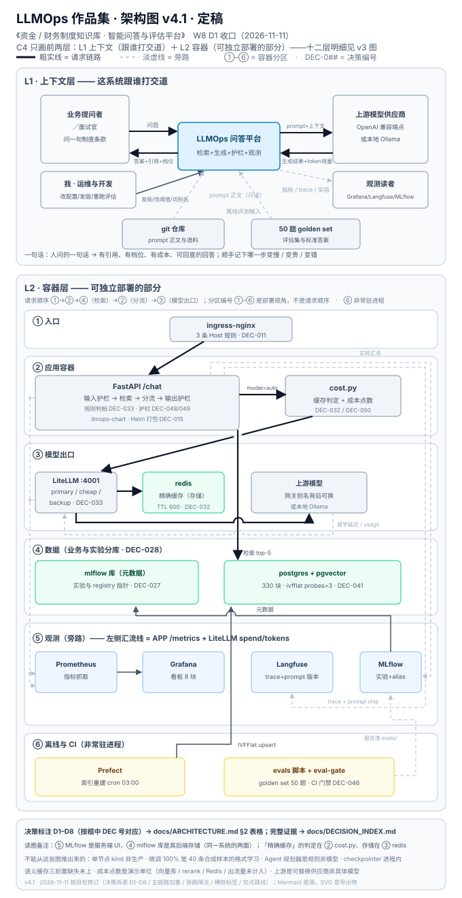
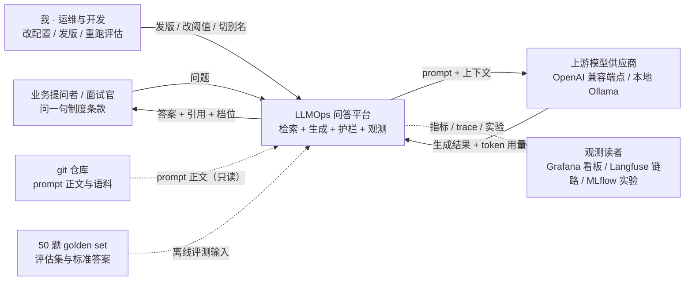
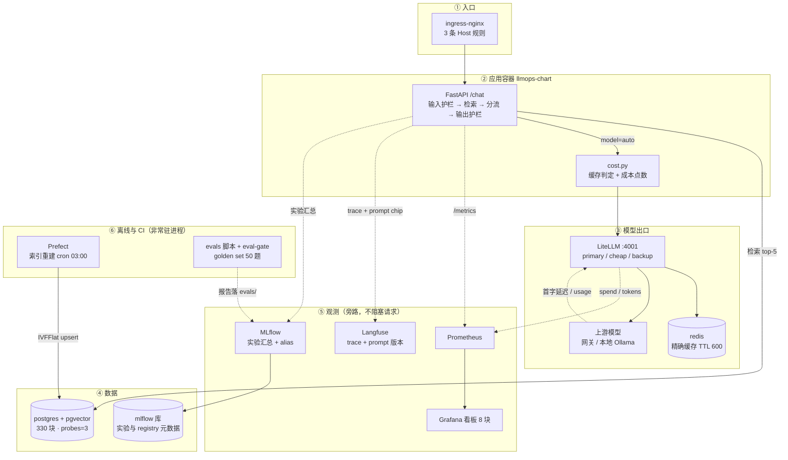

# 架构图终稿（C4 · 上下文层 + 容器层）

> **给谁看**：一个不懂 LLM 的人，看完能说出「这套系统在干什么、关键处为什么这么选」；一个懂行的工程师，能顺着图找到每一处的证据。
>
> **口径**：只画 C4 前两层。组件层（某个容器里分几块）留到 `docs/k8s-concepts.md` 与十二层读数表；代码层不画。**层数越多越难在 3 分钟内讲清**，这是有意的取舍，不是没画完。
>
> **配套**：决策标注的证据与复核条件在 [`DECISION_INDEX.md`](DECISION_INDEX.md)；十二层逐层读数（W4 版）在知识库 `作品集架构图 v3`。
>
> **静态版**：[`images/llmops-architecture-v4.1.svg`](images/llmops-architecture-v4.1.svg)（680×1320，两层图 + 边界说明；**8 条决策标注已从图里拆出**，见 §2 的 D1–D8 表格，图上不重复）。**Mermaid 是源，SVG 是导出物**：改图先改下面两段 Mermaid，再同步 SVG。
>
> **2026-11-11 目检修订（v4.1）**：分区用 ①–⑥、决策用 D1–D8，两套编号不再打架；粗实线只给请求链路、旁路与离线降淡；竖排标签全部改横排；交叉处加跳线弧。**主图现在只负责「怎么搭」，判断力由 §2 表格与 `DECISION_INDEX.md` 承担。**



---

## 1. 上下文层（L1）· 这系统跟谁打交道



**一句话**：把人问的一句话，变成一条**有引用、有档位、有成本、可回查**的回答；顺手把「哪一步变慢 / 变贵 / 变错」记下来。

四条边值得单独说：

| 边 | 为什么这么设计 | 证据 |
| --- | --- | --- |
| 提问者只看到「答案 + 引用 + 档位」 | 引用是产品要求，档位是成本透明；不暴露内部 trace | `app/main.py` 响应体 `routing` 字段 + 响应头 `X-Route-*` |
| 上游是**可替换的供应商**，不是一个具体模型 | 别名背后换过三次模型，应用代码零改动 | DEC-033 · `infra/litellm/config.yaml` |
| 观测是**旁路虚线** | trace / 指标异步上报，不阻塞请求；上报失败不影响回答 | `app/observability.py` |
| prompt 正文在 **git**，平台只读 | 正文有 diff / review / 回滚，registry 只存发布指针 | DEC-027 |

---

## 2. 容器层（L2）· 有哪些可独立部署的部分



> [!tip] 三个约定，先记住再看标注
> - **线有三档**：粗实线是请求链路（视觉上唯一满强度）；细实线是离线与数据流（如 `PREF --> PG`、`ML --> MLF`、`PR --> GF`）；淡虚线是旁路（`/metrics`、trace、实验汇总、`usage` 回传），都不阻塞回答，图上刻意压淡。线在交叉处断开跳线，表示「不相连」。
> - **分区编号 ①–⑥ 是部署视角，不是请求顺序**：请求实际走 ① 入口 → ② 应用 → ④ 数据（检索）→ ② 分流 → ③ 模型出口。按 ①→②→③ 读会读反。
> - **⑥ 不是容器**：Prefect 有服务但调度的是离线任务，`evals` 脚本与 CI 门禁是进程级工具。画进来是因为「评估」是这套系统的第四条数据流，不画就讲不全。
> - **④ 里两个库共用一个 postgres 实例**，但逻辑上分开：`rag_chunks` 是业务数据，MLflow 元数据是实验数据（DEC-028 定的独立 ns / 独立库）。⑤ 的 MLflow 是服务端 UI，④ 的 `mlflow 库` 是它的后端存储，同一系统的两面。

### 8 个决策标注（D1–D8）

图里的 **①–⑥ 是容器分区**，**D1–D8 是决策标注**——两套符号不共用，避免「图上是 ② 应用容器、表里 ② 是打包」这种对不上的情况。按请求顺序排：

| 编号 | 位置 | 决策 | 为什么不是另一个 | 一句话证据 |
| --- | --- | --- | --- | --- |
| D1 | ① 入口 | ingress-nginx 而非 NodePort | NodePort 在 kind 里宿主机访问不到；Host 路由能一条集群跑三个服务 | 三条 Host 各 **200**（DEC-011） |
| D2 | ② 打包 | Helm 而非裸 YAML | 一个应用十几个资源，Release 带 revision，回滚一条命令 | `infra/k8s/llmops-chart/`（DEC-015） |
| D3 | ② 检索 | 递归 B 400/50 + **RRF** | 512 硬切块尾完整率仅 **7.2%**；单路向量 hit@1 只 7/10 | hit@1 **7/10 → 10/10**（DEC-039 / DEC-040） |
| D4 | ② 分流 | **规则判档**而非 LLM 判路由 | LLM 判 0.5–2 s，规则 4.8–6.0 µs，差五个数量级 | 离线 **12/12** 与标注 0 条不符（DEC-033） |
| D5 | ② 护栏 | 格式错**最多修一次** + 固定兜底 | 无限重试放大调用；直接 500 让「模型抖一下」变服务不可用 | 30 条：误拦 0 / 漏拦 0（`evals/OUTPUT_GUARD_BENCH.md`） |
| D6 | ③ 出口 | 三档别名 + **精确缓存**，语义缓存暂缓 | 语义缓存三前置本机全缺，阈值写了也是编数 | 缓存 **1161.6 → 8.9 ms**，响应 id 相同（DEC-032） |
| D7 | ④ 数据 | 显式 `ivfflat.probes=3` | 默认 probes=1 只探 1 个聚类，生产掉分且随索引重建漂移 | 三次掉成 9/10、9/10、7/10 → probes=3 稳定 10/10（DEC-041） |
| D8 | ⑥ 评估 | CI 门禁**只用非 LLM 指标** | 上游限流会让 CI 红成与代码无关的假红 | `IDBasedContextRecall@5` **0.75** / 阈值 0.65，改坏模板塌到 **0.0**（DEC-046） |

> 8 条的完整证据路径与复核条件见 [`DECISION_INDEX.md`](DECISION_INDEX.md)。W7 的护栏 / 成本 / 微调 / Agent 原本没有编号，**2026-11-11 已补成 DEC-048 ~ DEC-052**，清单第七节是同口径正表。

---

## 3. 四条数据流（每条都要能在图上走通）

### ① 检索流：一句话 → 有引用的答案

```
问题 → 输入护栏（规则 9/10 + 模型补盲区）→ 递归 B 切块语料（330 块）
     → 向量路 + BM25 路 → RRF 融合 top-5 → 上下文
     → output_guard 组装（answer + citations 白名单）→ 回答
```

| 环节 | 关键数 | 能验的地方 |
| --- | --- | --- |
| 切块 | 递归 B 400/50 → 330 块；硬切块尾完整率 7.2% vs 按标点 42.8% | `scripts/w6d1_chunk_bench.py` |
| 融合 | hit@1 7/10 → **10/10**，MRR 0.825 → **1.0** | `scripts/w6d2_hybrid_bench.py` |
| 生产一致性 | 精确检索与离线基线逐项对上（330 行 / 10/10 / 7/10 / MRR 0.825） | `scripts/w6d1_verify_pgvector.py` |
| 精排 | 默认不开：净增 **2.2–2.4 s** 换不到 hit@1 提升 | `evals/RERANK_RECHECK.md` |

### ② 评估流：一次改动的结论从哪来

```
50 题 golden set → 单变量 A/B → RAGAS 四项（固定裁判）
                → 与噪声标尺比较 → 采纳 / 不采纳 → 写进 evals/ 报告
                → 非 LLM 门禁进 CI（20 题分层抽样，无 LLM 调用）
```

| 环节 | 关键数 | 能验的地方 |
| --- | --- | --- |
| 基线 | 全量 50 题四项 **0.9434 / 0.4768 / 0.8113 / 0.8591**，NaN 0 | `evals/RAGAS_BASELINE.md` |
| 归因 | 配对 Δ **+0.0046** < 不该变的噪声 **+0.0074** → 改动不采纳 | `evals/ATTRIBUTION.md` |
| 门禁 | `IDBasedContextRecall@5` 0.75 ≥ 0.65；改坏 query 模板塌到 **0.0** 且退出 1 | `scripts/w6d6_eval_gate.py` |
| 验收 | D3 双指标 **0.816 / 70.2%**（口径变更留痕，不回溯旧数字） | `evals/ACCEPTANCE.md`（DEC-047） |

### ③ 观测流：出问题时从哪查

```
应用 /metrics ──→ Prometheus ──→ Grafana（8 块：up / QPS / 错误率 / P95 + 4 条曲线）
网关 spend/tokens ──↗
应用 trace ──→ Langfuse（每次请求的链路 + prompt 版本）
MLflow run ──→ 实验汇总（哪版更好、好多少）
```

| 环节 | 关键数 | 能验的地方 |
| --- | --- | --- |
| 应用指标 | P95 `/chat` **4.75 ms**，QPS 0.212 → **0.929** | `infra/grafana/dashboards/` |
| 网关指标 | 17 请求 = 12 真调用 + 2 缓存 + 3 打不通，与上游 `/stats` 独立对账 | `scripts/gateway_load.py` |
| 分母陷阱 | `cache_misses` 只记一部分：教科书公式算 **50%**，真实 **11.6%** | DEC-035 |
| 链路 | `agent.run` 根 span + 3 个 `agent.tool.*` 子 span，父子层级已验 | `evals/AGENT_GRAPH.md` |

### ④ 成本流：钱花在哪、怎么省的

```
判档（规则 4.8–6.0 µs）→ cheap / primary
   → 精确缓存命中（TTL 600）→ 命中即返回，用量归零
   → 未命中 → 网关 → 上游
   → 成本点数按档位单价累计（每千次）
```

| 环节 | 关键数 | 能验的地方 |
| --- | --- | --- |
| 四组同条件压测 | **1754.6 → 626.5（−64.3%）**；只开分流 −61.5%，只开缓存 −27.8% | `evals/COST_BENCH.md` |
| 分流 | 一致率 **20/20**，便宜档 69.7%，命中率 28.4% | `scripts/w7d3_cost_bench.py` |
| 并发 | 8 并发 **1.05 s** vs 串行 **8.08 s ≈ 7.7×**，token 四组 **4810 / $0.001261** 一位不变 | `evals/batch_score.py`（DEC-031） |
| 边界 | 点数是演示单位；向量库 / rerank / Redis / 出流量四项未计入 | `evals/COST_BENCH.md` 边界节 |

> [!warning] 成本这条流最容易被误读
> −64.3% 是**在四组相同条件下只改缓存与分流**得到的点数降幅，不是账单降幅。真账单还要加非模型成本；这两件事在报告里分开写，汇报时也分开讲。

---

## 4. 为什么只画两层（C4 取舍）

| 层 | 回答什么 | 本项目 |
| --- | --- | --- |
| 1 上下文 | 系统跟谁打交道 | ✅ 第 1 节 |
| 2 容器 | 有哪些可独立部署的部分 | ✅ 第 2 节 |
| 3 组件 | 某个容器里分几块 | ○ 看十二层读数表与 `docs/k8s-concepts.md`，不画成图 |
| 4 代码 | 类与函数 | ❌ 不画，代码本身就是答案 |

**理由**：面试的 3 分钟里，多一层就多一次解释成本。层数从 v3 的十二层收到两层不是退步——十二层回答「都做了什么」，两层回答「为什么这么搭」，后者才是选型能力的证据。

---

## 5. 复现入口

| 想验什么 | 一条命令 | 期望 |
| --- | --- | --- |
| 三线验收（成本 / 微调 / 决策 / Agent 四条 demo 重跑 + 阈值判定） | `python scripts/w7d7_acceptance_check.py` | 三线全 PASS，退出码 0 |
| 成本四组压测 | `python scripts/w7d3_cost_bench.py` | 1754.6 → 626.5，−64.3% |
| 混合检索 hit@1 | `python scripts/w6d2_hybrid_bench.py` | 向量 7/10 → RRF 10/10 |
| 评估门禁自检 | `python scripts/w6d6_eval_gate.py --self-test` | 改坏模板塌到 0.0 且退出 1 |
| Agent 全链路 span | `python scripts/w7d6_langgraph_demo.py` | 8 场景 24/24，根 span + 3 子 span |
| 全量测试 | `python -m pytest` | 179 passed |

---

## 6. 不能从这张图推出来的东西

- **不是生产系统**：单节点 kind，无多可用区、无真实流量、无 SLA。
- **微调的 100% 不是业务效果**：40 条合成样本、4 类词语分类，只证明「格式行为可被 LoRA 学会」。
- **规划器是规则不是模型**：Agent 的 plan 节点按规则走，工具是固定表；换开放域任务要重写。
- **checkpointer 是进程内**：`InMemorySaver`，跨进程 / 跨重启续跑未做。
- **语义缓存没上**：三前置条件（embedding 端点 / RediSearch / redisvl）本机全缺，`similarity_threshold` 至今是暂定值。

## 相关

- 决策清单：[`DECISION_INDEX.md`](DECISION_INDEX.md)
- 决策原文：[`decisions.md`](decisions.md)
- 三层验收：[`evals/ACCEPTANCE_W7.md`](../evals/ACCEPTANCE_W7.md)
- K8s 概念与排错：[`k8s-concepts.md`](k8s-concepts.md) · [`kubectl-cheatsheet.md`](kubectl-cheatsheet.md)
